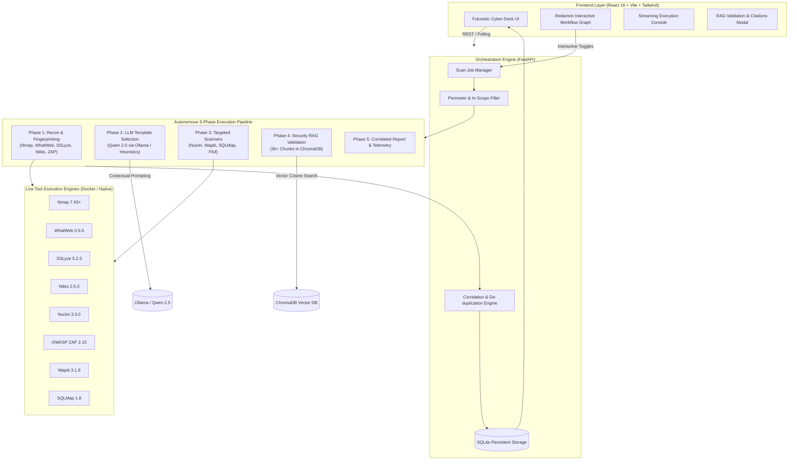

# Technical Architecture & System Specifications

> **ORVYN**: Autonomous Offensive Risk & Vulnerability Intelligence Network  
> *Next-Generation Autonomous DAST & Security Intelligence Platform*

---

## 1. Executive System Architecture

ORVYN is an autonomous penetration testing and offensive intelligence platform designed to eliminate static single-tool scans by orchestrating a dynamic multi-phase pipeline with LLM-guided template selection and RAG (Retrieval-Augmented Generation) knowledge verification.



---

## 2. Autonomous 5-Phase Pipeline Workflow

Rather than running tools as uncoordinated individual tasks, ORVYN executes scans in a choreographed five-phase lifecycle:

### Phase 1: Perimeter Reconnaissance & Fingerprinting
* **Engines**: `Nmap`, `WhatWeb`, `SSLyze`, `Nikto`, `OWASP ZAP`
* **Objective**: Discover open ports, identify server banners (`Apache`, `Nginx`, `Express`), detect SSL/TLS configurations and weak ciphers, and map web perimeter assets.
* **Timeout Guard**: Strict `60.0s` hard timeout prevents long-running network discovery from blocking subsequent phases.
* **Live Streaming**: Findings and execution logs stream live to the client terminal as they are discovered.

### Phase 2: LLM Reconnaissance Validation & Template Selection
* **Model**: `Qwen 2.5:7b` via local Ollama instance (with autonomous rule-engine fallback).
* **Objective**: Analyzes technologies discovered in Phase 1 (open ports, HTTP server headers, software frameworks) to automatically select the optimal assessment template from ORVYN's registry of 30 specialized templates (e.g. `cve-critical-rce`, `api-security-audit`, `wordpress-deep`, `cloud-perimeter`).
* **Output**:
  * Selected Template ID & Name
  * Confidence Score (0-100%)
  * Technical Rationale
  * Targeted Nuclei Template Tags (e.g. `tech,cve,misconfig,exposure`)
  * Recommended Secondary Attack Engines

### Phase 3: Targeted Tool Execution
* **Engines**: `Nuclei` (invoked with LLM-selected `-tags` and `-id` filters), `Wapiti` (parameter-level XSS/CSRF testing), `SQLMap` (database injection verification), and `Ffuf` (sensitive file & directory discovery).
* **Dynamic Secondary Engine Selection**: If Phase 1 outputs reveal database parameter errors, `SQLMap` is dynamically spawned; if hidden paths or 403 endpoints are found, `Ffuf` is launched.
* **Timeout Guard**: Wrapped with a `65.0s` deadline with automated graceful degradation.

### Phase 4: Security RAG Knowledge Base Triage
* **Vector Store**: ChromaDB with `all-MiniLM-L6-v2` embeddings over 5,000+ authoritative security chunks.
* **Corpus**:
  * OWASP Top 10:2025 Framework
  * NIST NVD Common Vulnerabilities and Exposures (CVE)
  * MITRE Common Weakness Enumeration (CWE)
  * Common Attack Pattern Enumeration and Classification (CAPEC)
* **Objective**: Compares discovered vulnerabilities against authoritative documentation to attach real CVE/CWE citations, validate severity tiers, and filter out false positives.

### Phase 5: Result Finalization & Deduplication
* Aggregates findings from all engines into unified `CorrelatedFinding` records.
* Groups findings that describe the same vulnerability across multiple tools (e.g., both Nikto and ZAP reporting missing `X-Content-Type-Options`).
* Boosts confidence ratings when multiple independent tools corroborate the finding.

---

## 3. Redamon Interactive Recon Pipeline Workflow

ORVYN includes an interactive circuit node-graph based on the **Redamon Reconnaissance Pipeline** specification:

```text
┌────────────────────────────────────────────────────────────────────────────────────────┐
│  UPPER DATA BAND:  [Domain]  [Subdomain]  [IP]  [Port]  [Service]  [BaseURL]  [Endpoint]  [CVE]   │
└────────────────────────────────────────────────────────────────────────────────────────┘
          ▲                ▲             ▲         ▲         ▲          ▲          ▲
          │                │             │         │         │          │          │
┌─────────┼────────────────┼─────────────┼─────────┼─────────┼──────────┼──────────┼─────────┐
│ STAGE 1 │    STAGE 2     │   STAGE 3   │ STAGE 4 │ STAGE 5 │ STAGE 6  │ STAGE 7  │ STAGE 8 │
│  Input  │   Discovery    │    OSINT    │  Ports  │ Probing │ Crawling │ JS Recon │  Vulns  │
│ [Target]│ [SubdomainDisc]│  [Shodan]   │ [Naabu] │ [Httpx] │ [Katana] │ [JSRecon]│[Nuclei] │
│         │   [URLScan]    │ [OSINTEnr]  │ [Nmap]  │[WhatWeb]│ [FFuf]   │ [Nikto]  │ [ZAP]   │
│         │   [Uncover]    │             │[Masscan]│[SSLyze] │ [Wapiti] │ [SQLMap] │         │
└─────────┼────────────────┼─────────────┼─────────┼─────────┼──────────┼──────────┼─────────┘
          │                │             │         │         │          │          │
          ▼                ▼             ▼         ▼         ▼          ▼          ▼
┌────────────────────────────────────────────────────────────────────────────────────────┐
│  LOWER DATA BAND: [DNSRecord] [Certificate] [Header] [Technology] [Parameter] [Secret]   │
│                   [ExternalDomain] [Vulnerability] [MitreData] [Capec]                │
└────────────────────────────────────────────────────────────────────────────────────────┘
```

### Graph Components & Capabilities

1. **Three Horizontal Bands**:
   * **Upper Data Band**: Data nodes created and consumed in early-to-mid stages (`Domain`, `Subdomain`, `IP`, `Port`, `Service`, `BaseURL`, `Endpoint`, `CVE`).
   * **Tool Band (Center)**: 9 consecutive scanning stages containing compact interactive cards.
   * **Lower Data Band**: Secondary data entities and security artifacts (`Technology`, `Secret`, `Parameter`, `Vulnerability`, `MitreData`, `Capec`).

2. **Interactive Tool Cards**:
   * **Toggle Switch**: Instant enable/disable switch on every tool. Disabling a tool updates dependency graphs in real-time.
   * **Chain-Breaking & Starved Node Alert**: If a data entity has no active producer (e.g. if `Httpx` and `GAU` are both disabled, `BaseURL` is starved), the node pulses red and downstream consumers display an amber warning icon (`⚠️`).
   * **Live Status Pill**: Shows `⚡ RUNNING`, `✓ COMPLETED (N findings)`, or `✕ ERROR`.
   * **Standalone Execution**: A play icon (`▶`) enables launching **Partial Recon** for any individual tool independently.
   * **Configuration Modal**: Gear icon (`⚙️`) opens tool-specific parameter tuning (timeouts, rate limits, wordlists).

3. **Data Bus Signal Traces**:
   * Right-angled SVG circuit traces connecting tools and entities.
   * Color-coded by data category:
     * **Blue (`#3b82f6`)**: Identity (`Domain`, `Subdomain`)
     * **Cyan (`#06b6d4`)**: Network (`IP`, `Port`, `Service`)
     * **Green (`#10b981`)**: Web (`BaseURL`, `Endpoint`, `Header`, `Parameter`)
     * **Purple (`#a855f7`)**: Technology & Frameworks
     * **Yellow (`#eab308`)**: Secrets & External Domains
     * **Red (`#f43f5e`)**: Security (`Vulnerability`, `CVE`, `MitreData`)

---

## 4. Multi-Scanner Integration Matrix

| Tool | Version | Mode | In-Scope Verification | Primary Data Produced | Fallback Behavior |
|------|---------|------|-----------------------|-----------------------|-------------------|
| **Nmap** | 7.93+ | Active | Host / CIDR | Port, Service, Technology | Automated Port Heuristics |
| **WhatWeb** | 0.5.5 | Active/Passive | Domain / URL | Technology, Server Banner | Tech Signature Matching |
| **SSLyze** | 5.2.0 | Active | Host:Port | Certificate, Vulnerability | TLS Cipher Benchmark Data |
| **Nikto** | 2.5.0 | Active | Web URL | Vulnerability, Misconfig | Web Misconfig Data |
| **Wapiti** | 3.1.8 | Active | URL + Query | XSS, CSRF, Parameter Flaws | Parameter Reflection Model |
| **Nuclei** | 3.3.0 | Active | BaseURL / Host | CVE, MitreData, Capec | Curated CVE Catalog |
| **OWASP ZAP** | 2.15 | Active | Web URL | OWASP Top 10 Alerts | OWASP Baseline Dataset |
| **SQLMap** | 1.8 | Active | URL + Params | SQL Injection Flaws | Blind Injection Heuristic |
| **FFuf** | 2.1 | Active | Web BaseURL | Hidden Endpoints, .env | Fuzzing Wordlist Results |

---

## 5. Security & System Administration

### SELinux `nnp_transition` (No-New-Privileges)

On Fedora, CentOS, and RHEL Linux distributions, Docker and Podman execute containerized subprocesses with `PR_SET_NO_NEW_PRIVS`. When a containerized tool spawns subshells (`/bin/bash`), SELinux checks the `nnp_transition` permission.

To prevent desktop alert interruptions while developing with ORVYN containers:
```bash
# Allow container management transitions
sudo setsebool -P container_manage_cgroup 1

# Or silence setroubleshoot desktop notifications:
sudo systemctl stop setroubleshootd
```

### Process Deadlock Prevention

All tool wrapper subprocesses are orchestrated through `asyncio.subprocess` using non-blocking buffered readers guarded by strict timeouts. Child processes are automatically killed with `SIGKILL` upon timeout to prevent zombie background processes.
